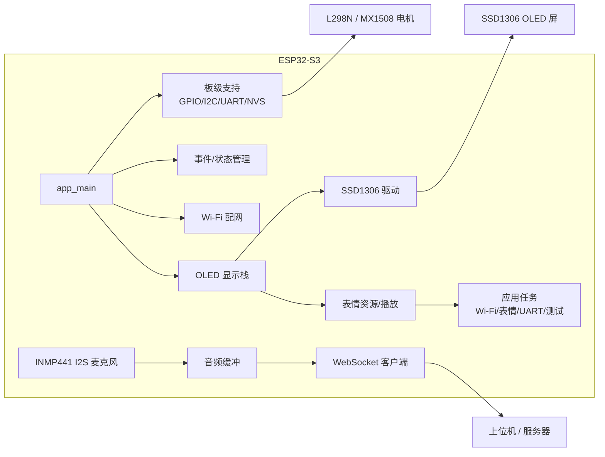

[English](README.md) | [简体中文](README_CN.md)

# 项目标题

<h1 align="center">🐾 基于 ESP32-S3 的电子桌面宠物</h1>
<p align="center">
  <b>ESP32-S3 Electronic Desktop Pet</b> · 毕业设计作品<br>
  SSD1306 表情引擎 · I2S 语音流 · WebSocket 传输 · 事件 / 状态驱动固件
</p>

<p align="center">
  
  
  
  
</p>

<!-- TODO: 实物图 / 演示动图，建议 320~480px 宽，放到 docs/images/ 下
<p align="center">
  
</p>
-->

---

## 📌 先看这里（项目状态）

> **✅ 本仓库是当前活跃版本，也是固件的唯一事实来源（single source of truth）。**

| 仓库 | 状态 | 说明 |
| --- | --- | --- |
| [ESP32-Based-Electronic-Desktop-Pet](https://github.com/Midst-exe/ESP32-Based-Electronic-Desktop-Pet)（本仓库） | 🟢 活跃 | 当前 ESP-IDF 实现，请以此为准 |
| [Design-and-Implementation-of-an-ESP32-Based-Electronic-Desktop-Pet](https://github.com/Midst-exe/Design-and-Implementation-of-an-ESP32-Based-Electronic-Desktop-Pet) | ⚪ 存档 | 早期毕业设计存档，**请勿使用** |

> ⚠️ 硬件相关功能尚未发布「可复现的验证记录 / 固件二进制」。评审或二次开发前，请先按下方「验证清单」在你的板子上实际验证。

## 📖 项目简介

这是一个基于 **ESP32-S3** 的电子桌面宠物，使用 **ESP-IDF** 开发，将「表情显示 + 语音交互 + 动作反馈」整合到一个小体积设备上：

- **表情引擎**：在 SSD1306 OLED 上播放位图式面部动画（正常、眨眼、单眼 wink、聚焦等）；
- **语音流**：INMP441 I2S 麦克风采集音频，经 WebSocket 以二进制流发送到上位机 / 服务器；
- **动作反馈**：预留 L298N / MX1508 电机驱动接口，用于宠物的物理动作；
- **工程化架构**：事件管理 + 状态管理 + FreeRTOS 任务，组件化、可维护。

> 一句话：这是一个从「能跑的原型」向「可维护、可评审的嵌入式工程」演进的毕业设计作品。

## ✨ 功能特性

- **ESP32-S3 固件基础**：基于 ESP-IDF v6.0.1，构建目标锁定于 `dependencies.lock`；
- **SSD1306 OLED 显示栈**：driver / framebuffer / graphics / font / 位图资源分层设计；
- **表情播放**：位图式面部动画（`normal` / `blink` / `wink_right` / `Focused` 等）；
- **事件与状态管理**：协调系统状态（含 Wi-Fi 配置状态）；
- **Wi-Fi 配网流程** + Web 服务器组件（配置状态交互 UI，见 `components/WebServer/web_resource/index.html`）；
- **应用层任务**：Wi-Fi 初始化、表情更新、UART 发送、测试钩子；
- **板级支持层**：I2C / UART / GPIO / NVS 初始化；
- **Arduino 原型**（`main/main.ino`）：I2S 麦克风采集、WebSocket 音频流、OLED 表情、电机更新 —— 与 ESP-IDF 入口分离，属实验性参考实现。

## 🧱 系统架构



**数据流（语音方向）**：`INMP441（I2S 采集）→ 音频缓冲 → WebSocket 客户端 → 上位机 / 服务器`（在 `main.ino` 原型中实现）。

## 🛠 硬件清单与接线

> ⚠️ **两个入口的引脚定义不同，请勿混用。** 实际定义以 `components/board/include/Hardware_Pin.h` 为准，接线前务必对照你自己的原理图与电平。

**ESP-IDF 入口（`main/main.cpp`）：**

| 模块 | 接口 | ESP32-S3 引脚 |
| --- | --- | --- |
| SSD1306 OLED（0.96 寸） | I2C | SCL = GPIO16，SDA = GPIO15（地址 0x3C / 0x3D） |
| INMP441 麦克风 | I2S | SCK = GPIO11，WS = GPIO12，SD = GPIO8 |
| MAX98357A 功放 | I2S | LRC = GPIO12，BCLK = GPIO11，DIN = GPIO10 |
| MX1508 电机驱动 | GPIO | IN1 = GPIO4，IN2 = GPIO5，IN3 = GPIO6，IN4 = GPIO7 |

**Arduino 原型（`main/main.ino`）：**

| 模块 | 接口 | ESP32-S3 引脚 |
| --- | --- | --- |
| SSD1306 OLED（0.96 寸） | I2C | SCL = GPIO1，SDA = GPIO2 |
| INMP441 麦克风 | I2S | SCK = GPIO4，WS = GPIO5，SD = GPIO6 |
| L298N 电机驱动 | GPIO | IN1 = GPIO15，IN2 = GPIO16，IN3 = GPIO17，IN4 = GPIO18 |

**建议模块清单**：ESP32-S3 开发板、SSD1306 0.96 寸 OLED、INMP441 I2S 麦克风、MAX98357A I2S 功放、L298N / MX1508 电机驱动、小电机或舵机。

## 📁 目录结构

| 路径 | 作用 |
| --- | --- |
| `main/main.cpp` | ESP-IDF 应用入口 |
| `main/main.ino` | Arduino 原型（实验性，与 ESP-IDF 分离） |
| `components/Oled` | SSD1306 驱动、framebuffer、graphics |
| `components/Oled_resource` | 表情位图、字体资源 |
| `components/Expressions` | 表情动画逻辑 |
| `components/State_Manager` | 系统状态与 Wi-Fi 配置状态 |
| `components/Event_Manager` | 事件定义与分发 |
| `components/WebServer` | 配网相关 Web 服务器组件 |
| `components/Wifi` | Wi-Fi 连接 |
| `components/App_tasks` | 应用层 FreeRTOS 任务 |
| `components/board` | 板级支持与外围初始化 |
| `components/Action` | 动作（电机）接口 |

## 🚀 快速开始

### 环境要求

- **ESP-IDF v6.0.1**（与 `dependencies.lock` 记录一致）
- ESP32-S3 开发板
- USB 串口连接

### 构建与烧录（ESP-IDF）

```bash
git clone https://github.com/Midst-exe/ESP32-Based-Electronic-Desktop-Pet.git
cd ESP32-Based-Electronic-Desktop-Pet

idf.py set-target esp32s3
idf.py build
idf.py -p <PORT> flash monitor
```

> 将 `<PORT>` 替换为你的串口（Windows 如 `COM3`，Linux 如 `/dev/ttyACM0`）。

### 运行 Arduino 原型（可选）

1. 用 Arduino IDE 打开 `main/main.ino`；
2. 安装依赖库（`Adafruit_SSD1306`、`ArduinoJson`、`WebSockets`、`NetworkManager` 等）；
3. 修改文件顶部的 Wi-Fi 与 WebSocket 服务器地址为你的环境；
4. 编译烧录。

> 🔒 原型中硬编码了 Wi-Fi 与服务器地址，**请勿提交真实凭据**，建议改为配网 / 本地配置文件。

## ✅ 验证结果

> 本部分需补充真实素材（截图 / 照片 / 串口日志）。下表为模板，替换即可。

| 验证项 | 结果 | 证据 |
| --- | --- | --- |
| 固件可构建 | ✅ | `idf.py build` 成功 |
| OLED 表情显示 | ⏳ 待补充 | 替换为 `docs/images/oled.jpg` |
| Wi-Fi 配网 | ⏳ 待补充 | 替换为串口日志 |
| 麦克风采集 | ⏳ 待验证 | — |
| 电机动作 | ⏳ 待验证 | — |

**验证清单（Checklist）**

1. [ ] `idf.py build` 构建成功；
2. [ ] 烧录后串口监视器正常输出；
3. [ ] I2C / OLED 初始化成功、基础表情正常渲染；
4. [ ] Wi-Fi 配网路径可用、状态上报正确；
5. [ ] 电机控制正常（**先空载测试**）。

**串口日志模板**（示例，替换为你的真实输出）：

```text
I (123) MAIN: 系统初始化成功
I (234) OLED: SSD1306 initialized at 0x3C
I (345) WIFI: connected, IP: 192.168.x.x
```

## 🗺 Roadmap

- [ ] 补充接线图与实物照片
- [ ] 发布演示视频 / GIF
- [ ] 补充可复现的硬件验证清单与串口日志证据
- [ ] 收敛 Arduino 原型与 ESP-IDF 实现（合并或清晰分离）
- [ ] 添加 License 与 release tag
- [ ] 移除源码中的硬编码凭据，改用配网机制

## 📄 License

尚未指定许可证。在允许他人复用之前，请添加 `LICENSE` 文件。

## 🙏 参考与致谢

- [ESP-IDF 官方文档](https://docs.espressif.com/projects/esp-idf/)
- [Adafruit SSD1306](https://github.com/adafruit/Adafruit_SSD1306)
- **个人项目，恳请指正！**
